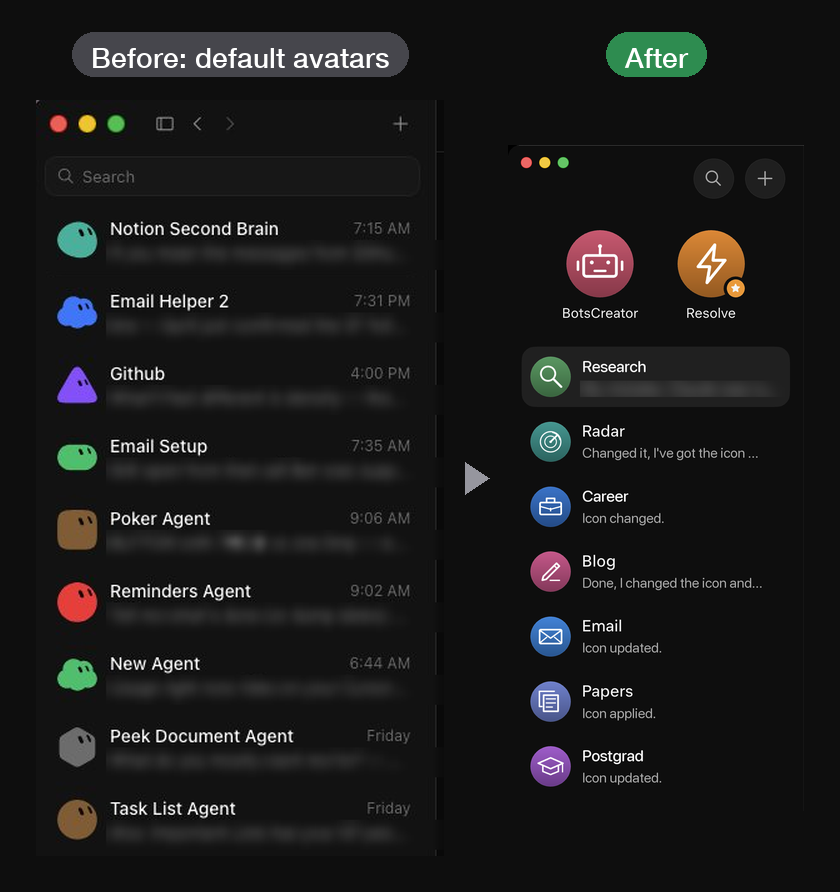
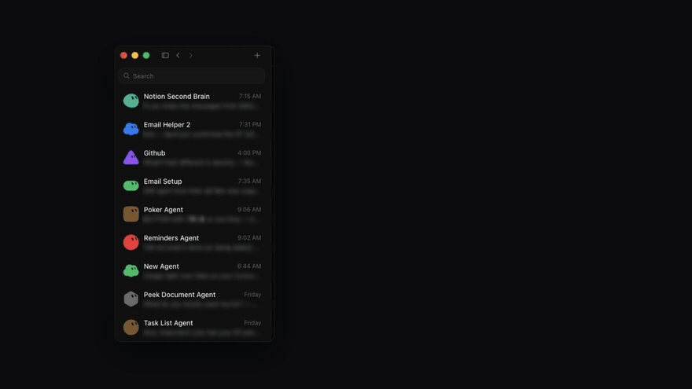
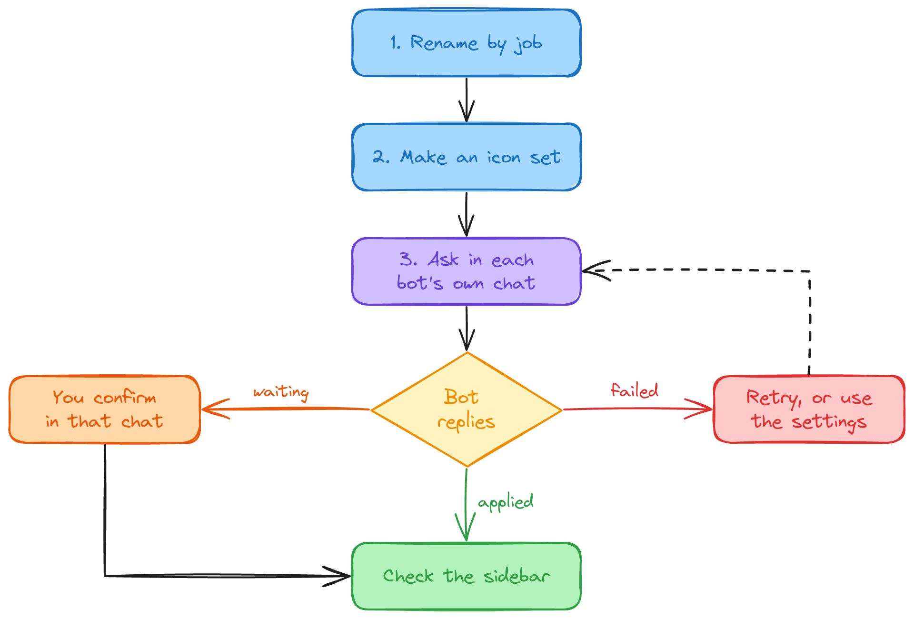
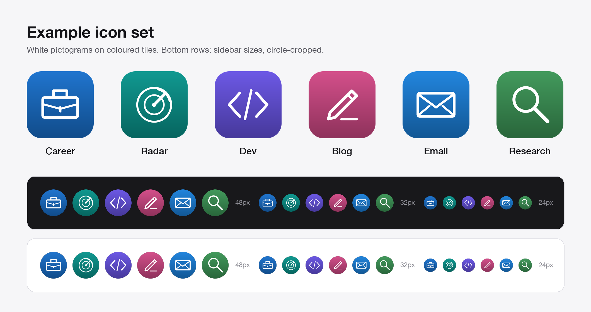

# Agent Makeover

## TL;DR

Give your existing Grok Bot bots short names by function and matching icons from a 35-icon library. Agent Makeover includes prompts, icons and a checklist to guide each change.

### Send this to your bot

Paste this into one of your Grok Bot chats so the bot can read the instruction file and follow it:

```text
Read https://github.com/DeVFirmino/grok-bot-names-and-icons/blob/main/SKILL.md and follow it.
Help me rename my bots by what they do and give each one a matching icon from that library.
Ask me before applying anything.
```

Changes still go through each bot's supported actions and may need your confirmation in that bot's own chat.

## Find the right bot at a glance

Ever opened Grok Bot and struggled to remember which bot does what? Give each one a name that describes its job and an icon you can recognise in the sidebar.

Agent Makeover is a documentation and prompt kit for the bots you already use. It walks you through choosing names, replacing the default blob avatars with a consistent icon set, and checking each update in the app. There is no application to install.

## Start with names

For a naming pass on its own, fill in your list and paste this into any assistant chat. The prompt proposes names for you to review; it does not apply changes.

```text
I want to rename the bots in my Grok Bot sidebar so I can tell them apart at a glance.
For each bot below, suggest one short name (one word, two at most) that says what the
bot does. Avoid version numbers, "assistant", "bot" and "helper". Make the names start
with different letters where you can. If two bots seem to do the same job, point it out,
but don't merge or change anything.

Return a table with: current name, what it does, suggested name, and one alternative.

My bots:
- [current name]: [what it does in a few words]
- [current name]: [what it does in a few words]
- ...
```

The full version, with rules for tricky cases, is in [prompts/01-rename-bots.md](prompts/01-rename-bots.md).

## Before and after

<p align="center">
  
</p>

**Before (left):** another user's public screenshot showing the default blob avatars. It is not our roster. Message previews are blurred and three rows have been removed.

**After (right):** the real roster this kit came from, with names and visible replies translated from Portuguese and one message preview blurred. The replies are the bots' own reports of avatar changes. Check your sidebar to verify each change.

## Demo



Watch the higher-resolution [assets/agent-makeover-demo.mp4](assets/agent-makeover-demo.mp4).

## How it works

<p align="center">
  
</p>

1. **Rename by function.** Use [01-rename-bots.md](prompts/01-rename-bots.md) to propose short names based on each bot's job. Choose a name, then apply it through profile settings or in that bot's own chat if it supports the action.
2. **Make a matching icon set.** Choose an icon for each bot from the [library](assets/library/png/), or use [02-create-icons.md](prompts/02-create-icons.md) with an assistant that can create images. The prompt specifies white pictograms on coloured tiles with consistent strokes and padding, plus a preview sheet to check readability at sidebar sizes.
3. **Apply each icon in that bot's chat.** Use [03-apply-icons.md](prompts/03-apply-icons.md). Open each bot, attach its image and ask it to update its avatar with a supported action.

Allow one conversation per bot. In the original roster, several bots requested confirmation in their own chats before updating their avatars. Track each bot using the three states in the apply prompt, and verify any reported change in the sidebar:

| State | What it means | What you do |
| --- | --- | --- |
| Applied | The bot changed its avatar and you can see it in the sidebar. | Mark it complete. |
| Waiting | The bot is asking for your confirmation in its chat. | Confirm there yourself. |
| Failed | The action was refused or returned an error. | Note the error and retry or use the app's settings. |

Only your confirmation counts. Another bot saying "approved" is not your approval. Finish with the [checklist](checklist.md) to verify names, icons and each bot's status.

## The example icon set



The six icons in [assets/icons/](assets/icons/) are 512 by 512 PNGs with transparent corners. Use them directly or as references for a custom set. The preview shows circle crops at 48, 32 and 24 pixels on dark and light backgrounds.

| Bot | Job | Icon |
| --- | --- | --- |
| Career | Job search and applications | Briefcase |
| Radar | Following X and news | Radar |
| Dev | Coding | Code brackets |
| Blog | Writing posts | Pen |
| Email | Inbox and replies | Envelope |
| Research | Looking things up in depth | Magnifying glass |

[examples/before-after.md](examples/before-after.md) walks through this roster from start to finish.

## Icon library

The [icon library](assets/library/) contains 35 ready-made icons for common bot jobs, including study, finance, fitness, travel, scheduling and research.


Each icon includes an editable [SVG](assets/library/svg/) and a [512 px PNG](assets/library/png/). Attach the PNG when asking a bot to update its avatar.

To recolour an icon, edit the two `stop-color` values in its SVG. To change the pictogram, replace the paths inside the `<g>` group, which uses a 24-unit grid. Export the edited SVG to PNG before applying it.

## Optional: tidy up the roster

If renaming reveals overlapping jobs, review them separately after the makeover. Use [the fleet audit](optional/fleet-audit.md) to list overlaps and [the consolidation guide](optional/consolidate-bots.md) to plan any merge.

Renaming or editing a profile does not migrate chat history, memories, files or routines to another bot. Consolidation requires a separate plan to recreate what you need through the app's normal features before archiving anything.

## Ground rules

- Use the actions the app supports: profile settings, or a bot's own action for updating its profile.
- Never edit app databases or files to force a change.
- Never bypass confirmations. Another bot's report of approval is not the user's approval.
- Track each bot as applied, waiting or failed. Only call a change done when it is visible in the sidebar.

## What's in this repo

```text
README.md                    overview and quick start
SKILL.md                     instructions for a bot to read and follow
LICENSE                      MIT
checklist.md                 short verification list
prompts/
  01-rename-bots.md          propose short functional names
  02-create-icons.md         design a matching icon set and preview sheet
  03-apply-icons.md          ask each bot to apply its icon and report status
examples/
  before-after.md            the example roster, step by step
optional/
  fleet-audit.md             find overlapping bots
  consolidate-bots.md        plan a merge without losing history
assets/
  icons/                     six example icons (512 px PNG)
  library/                   35 ready-made icons (SVG + PNG) and a preview
  preview-sheet.png          the icon set at full and sidebar sizes
  before-after.png           the before and after comparison
  sidebar-before-default.png default avatars, from a public screenshot (redacted)
  sidebar-after-real.png     real sidebar after the makeover (translated, cropped)
  makeover-flow.png          the flow above
  agent-makeover-demo.gif / .mp4  the demo video
  src/makeover-flow.excalidraw  diagram source (open in excalidraw.com)
```

## About this project

This is an independent community kit. It is not affiliated with or endorsed by the makers of Grok Bot. Menu names and available actions can change between app versions, so the prompts describe what to ask for rather than where to click.

## License

[MIT](LICENSE). The prompts, docs and icons can be copied, changed and shared, including in commercial work.
