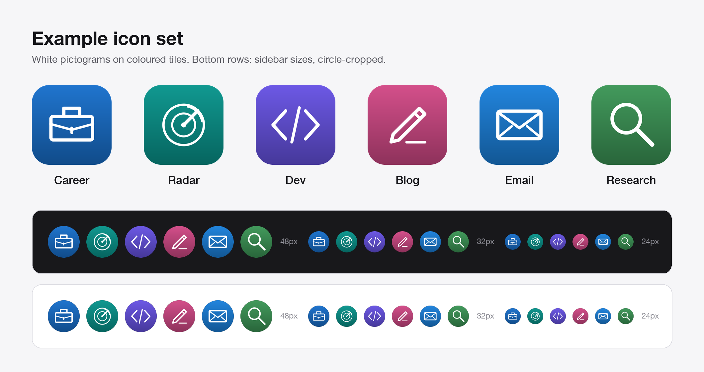
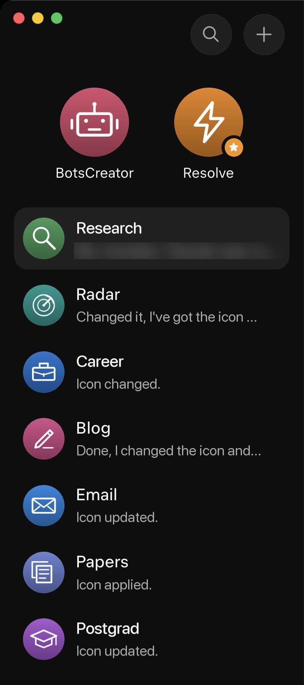

# Before and after: an example roster

This walks through a six-bot sidebar from start to finish. The "before" names are invented for the example. The jobs, new names and icons match the roster this kit came from, translated into English.

## 1. The starting point

| Before (example) | What it was used for | Avatar |
| --- | --- | --- |
| JobHunter Pro v2 | Finding roles, tailoring applications | Default shape |
| XFeed Watcher | Following X and news | Default shape |
| Code Helper (new) | Coding and debugging | Default shape |
| Writer Assistant 2 | Drafting blog posts | Default shape |
| Inbox Thing | Email triage and replies | Default shape |
| Deep Research Bot | Long research reports | Default shape |

Three of the names describe the bot rather than the job ("Helper", "Assistant", "Bot"), two carry a version, and the default avatars don't help tell them apart.

## 2. New names

Running [the rename prompt](../prompts/01-rename-bots.md) on this list gives one word per job:

| Before (example) | After |
| --- | --- |
| JobHunter Pro v2 | Career |
| XFeed Watcher | Radar |
| Code Helper (new) | Dev |
| Writer Assistant 2 | Blog |
| Inbox Thing | Email |
| Deep Research Bot | Research |

"Radar" is the one name that isn't literal. It was kept because it's short and the icon makes the meaning obvious.

## 3. Icons

Each new name gets one pictogram from [the icon prompt](../prompts/02-create-icons.md):

| Bot | Pictogram | File |
| --- | --- | --- |
| Career | Briefcase | [career.png](../assets/icons/career.png) |
| Radar | Radar sweep | [radar.png](../assets/icons/radar.png) |
| Dev | Code brackets | [dev.png](../assets/icons/dev.png) |
| Blog | Pen | [blog.png](../assets/icons/blog.png) |
| Email | Envelope | [email.png](../assets/icons/email.png) |
| Research | Magnifying glass | [research.png](../assets/icons/research.png) |



## 4. Applying them

Each bot got [the apply prompt](../prompts/03-apply-icons.md) in its own chat, with its icon attached. In the original roster, some bots changed their picture straight away and several asked for confirmation in their chat first, so this took one conversation per bot.

A status list for this step might look like the one below. It is an illustration of the format, not a record of the original session.

```text
Career    applied
Radar     applied
Dev       waiting   confirm in Dev's chat
Blog      applied
Email     applied
Research  applied
```

After confirming Dev in its own chat, check the sidebar and tick off the [checklist](../checklist.md).

## 5. The result



That screenshot is from the original roster, which has a few more bots than this example (Papers and Postgrad, for instance). Names and replies are translated from Portuguese and one message preview is blurred.
